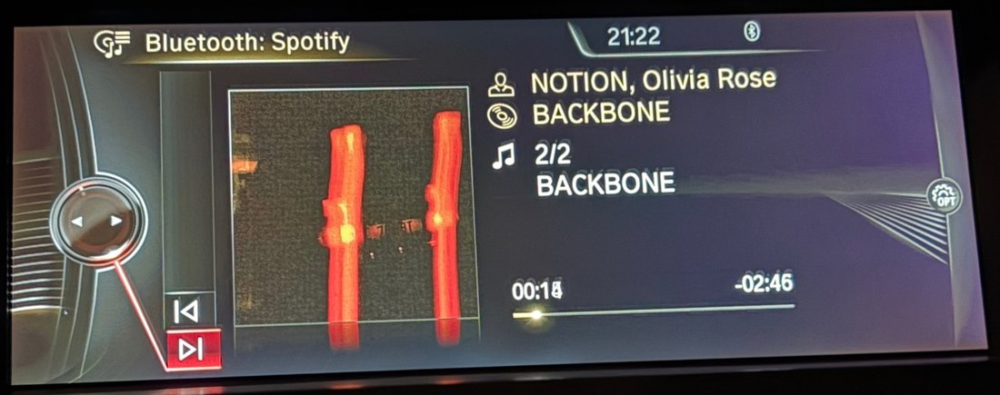
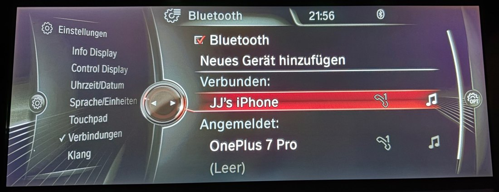
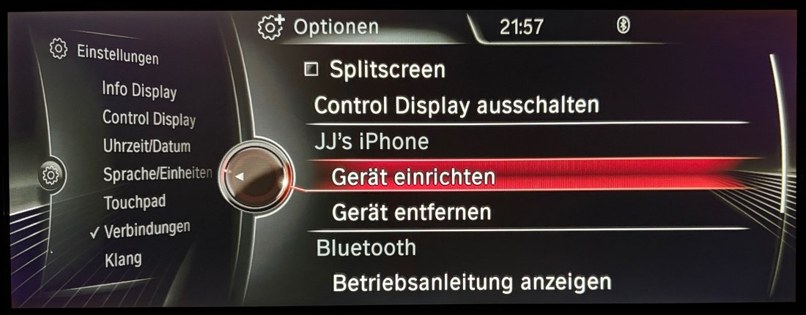
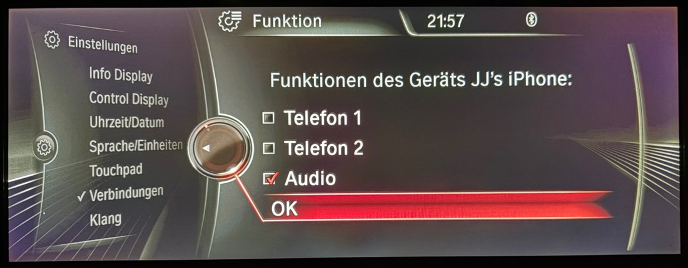

# NBT Android Auto

Wired Android Auto and wired Apple CarPlay for the **original BMW NBT head unit** (CIC successor, 2013–2016, QNX 6.5
on x86), with no extra hardware. The phone's picture fills the display with every pixel, you control it with the
iDrive controller, the music shows with title and cover like a built-in source, and turn-by-turn guidance shows up in
the instrument cluster.

> **Status: community prototype.** It works in the developer's car (BMW F07, 2014, OnePlus 7 Pro, iPhone 17 Air). It
> has not been tested on other cars, other NBT software levels (I-Stufen) or NBT Evo. CarPlay and the new picture path
> are new in 2026.11.24.2. Read the [disclaimer](#disclaimer) first.

**Thanks to Valentin Radu ([valinet](https://github.com/valinet/nbt-android-auto)):** the sharp picture, hardware
decoding, CarPlay and the head unit reset are his work, see [Credits](#credits).

🎬 **Sneak peek:** [see it running in the car (Instagram video)](https://www.instagram.com/reel/DfkW1wYsB__/)

🇩🇪 **Deutsch:** Kurzfassung [weiter unten](#deutsch), Installationsanleitung in [installer/README.md](installer/README.md).

## Features

- **Android Auto over USB**: any Android phone, no phone-specific configuration.
- **Apple CarPlay over USB** (since 2026.11.24.2): plug in an iPhone; the NBT's own USB port and Apple chip are used, no
  adapter. Siri and calls use the car's microphone. Details and limits: [docs/CARPLAY.md](docs/CARPLAY.md).
- **Sharp picture** (since 2026.11.24.2): 1280x480, every display pixel is a phone pixel, 30 pictures a second, decoded by the
  car's own H.264 decoder. A **Decoder** button on the page switches between hardware and software decoding.
  Details: [docs/DECODER.md](docs/DECODER.md).
- **iDrive controller**: turn = rotate, tilt = D-pad, press = OK, BACK = back. MENU / MEDIA / NAV / COM / OPTION leave
  the phone's picture, which keeps running in the background.
- **Menu entry** *Multimedia → Android Auto / CarPlay*: shows the status, starts the service 15 s after the HMI boots
  and brings a running session to the front.
- **Sound with title and cover**: the phone's music appears under Multimedia like a built-in source, with title,
  artist, album, cover and progress, also in the instrument cluster; skip works from iDrive, the steering wheel and
  the radio panel keys. Works for Android Auto and CarPlay; the phone has to be connected by Bluetooth as well
  (see [Sound](#sound)).
- **Navigation in the instrument cluster** (6WB cluster) while Google Maps or Apple Maps guides a route: arrow,
  distance bar, street name; with Android Auto also motorway/road shields and lanes (lanes not yet confirmed with a
  real phone). BMW navigation takes priority when it guides itself.
- **Restart buttons** on the page: **Restart Android Auto** restarts only the service and saves a diagnostic snapshot
  first; **Restart NBT** restarts the whole head unit after a confirmation.

## Sound

The phone's sound does not need an AUX cable or the phone's own Bluetooth music entry. It plays through an Apple
entry that this project adds under Multimedia, so iDrive shows what is playing and the skip keys work:



**Android Auto:** plug the phone in by USB, then connect it by Bluetooth. If Bluetooth was connected before (for
example when you got in), switch Bluetooth on the phone off and on once.

**CarPlay:** the iPhone is paired by Bluetooth too, but with **only "Audio" enabled**:

1. Pair the iPhone with the car: Settings → Connections → Bluetooth → Add new device.

   
2. Select the iPhone, press OPTION and choose **Configure device**.

   
3. Enable only **Audio**; Telephone 1 and Telephone 2 stay off. Calls and Siri then stay in CarPlay and use the car's
   microphone.

   
4. On the iPhone, pick **CarPlay** as the audio output.

Navigation prompts of Android Auto still come from the phone over its normal Bluetooth connection.

## Known limitations

- **Sound needs Bluetooth:** see [Sound](#sound). The phone has to connect by Bluetooth while the service is already
  running (USB first, then Bluetooth). Tested with one Android phone and one iPhone.
- **One kind of phone per start of the head unit:** after an Android phone, an iPhone only works after a restart of
  the head unit, and the other way round. The page then shows "Restart the NBT first"; **Restart NBT** is below it.
- **Decoder change needs a restart of the head unit** (the Decoder button says so).
- **CarPlay loads the head unit heavily** (about 98 % CPU on the developer's car): iDrive can feel slower while it
  runs. CarPlay turn hints in the cluster: only start, left and right were seen so far.
- **New picture path, one car:** if the picture stays away on your car, the stock player path of earlier versions
  (800x480) is still in the package: create the file `decoder.off` in `/var/opt/hmi/data/rw/NbtAndroidAutoRT` and
  restart the head unit. Please report it.
- **Restart NBT** needs the address of the car's gateway. The installer has a Gateway field with a Search button and looks it up itself if the field is empty; without an address the page says
  "Gateway not reachable" ([src/idrive/reboot/README.md](src/idrive/reboot/README.md)).
- No map picture in the instrument cluster: the 6WB cluster shows pictures only in its top line (turn arrow, shields).
- Switch iDrive split screen off (OPTION → split screen off): the picture uses the whole display.
- **Wired only.** Wireless Android Auto is not built in. One user reports that an aftermarket wireless Android Auto
  adapter on the car's USB port works in an F11, with occasional disconnects
  ([#3](https://github.com/JayJay3071/nbt-android-auto/issues/3)); I have not tested this myself.
- Tested with one car, one Android phone and one iPhone only.

What changed between versions: [CHANGELOG.md](CHANGELOG.md).

## Requirements

- BMW with the **original NBT** (not NBT Evo, not CIC). NBT Evo uses a different DSI library and is not supported.
- **SSH root access to the NBT** and its root password. The installer does not set this up for you, see
  [Getting SSH access](#getting-ssh-access).
- A laptop connected to the car with an **ENET cable** (the NBT usually answers at `169.254.199.99`).
- A USB cable for the phone.

## Getting SSH access

The stock NBT does not accept SSH logins, so SSH has to be unlocked (patched) once before you can install anything.

- **How it was done on the developer's car:** with **FeatureInstaller**. It can take **several attempts**. The last
  step sometimes reports **errors even though SSH access was enabled**, so try to connect (for example
  `ssh root@169.254.199.99`) before you assume it failed.
- **Root password:** it can be looked up in this forum thread:
  [SSH access guide (supramkv.com)](https://www.supramkv.com/threads/ssh-access-guide-supra-nbtevo-headunit.24190/).
  The thread is about the NBT Evo in the Toyota Supra; the root password is given there.

Unlocking SSH changes the head unit's configuration. As with everything here, you do it at your own risk.

## Install

1. Download the installer from [Releases](../../releases): `NBT-AndroidAuto-Installer.exe` (Windows) or the macOS app.
   Alternatively run the Python version: `pip install "paramiko>=3.4,<4"`, then `python installer/nbt_aa_installer.py`
   with the `payload/` folder from the release next to it.
2. Connect the ENET cable, ignition on, enter IP address and root password, click **Install / Update**.
3. Restart the iDrive.
4. Plug in the phone and choose **Multimedia → Android Auto / CarPlay**. An iPhone asks "Trust this computer?" the
   first time.

The installer writes only two folders (`/var/opt/hmi/data/rw/NbtAndroidAutoRT/` and
`/var/opt/hmi/data/rw/Plugins/NbtAndroidAuto/`), verifies every file byte by byte and can uninstall them again. It
never stores your password. Details: [installer/README.md](installer/README.md).

**Unsigned binaries:** the Windows .exe is not code-signed yet, so Windows 11 *Smart App Control* may block it. Use the
Python version in that case; please do not switch off Smart App Control for this. The macOS app is not notarized: open
it with right-click → Open.

## Reporting problems

Use **Save diagnostic logs** in the installer and attach the ZIP to a
[bug report](../../issues/new?template=bug_report.md). Please include car model, build year, NBT software level and
phone model.

## How it works (short)

```
Android phone ──USB/AOA──▶ oneplus_native (Android Auto protocol, TLS) ──┐ H.264
iPhone ──USB (NCM, iAP2, AirPlay)──▶ nbt_carplay ────────────────────────┤ annexb.fifo
                                                                         ▼
                              nbt_decoder ──▶ the head unit's NVIDIA video interface (1280x480, own window)
nbt_knob    ── watches iDrive controller events (MOST, CCS) ──▶ input.fifo ──▶ keys for the phone
nbt_aa_wms, nbt_ipod_tap, nbt_aa_ipod ── the phone's sound, titles and cover as an Apple entry under Multimedia
nbt_cluster ── navigation state from the phone ──▶ instrument cluster (HUDTerminal)
NbtAndroidAuto (HMI plugin) ── menu entry, status page, buttons, autostart via boot.sh
```

More: [docs/DECODER.md](docs/DECODER.md), [docs/CARPLAY.md](docs/CARPLAY.md),
[docs/HW-VIDEO-PATH.md](docs/HW-VIDEO-PATH.md) (the stock player path of earlier versions),
[docs/CLUSTER-HUDTERMINAL.md](docs/CLUSTER-HUDTERMINAL.md), [docs/ANDROID-AUTO.md](docs/ANDROID-AUTO.md). Older experiments (PNG pipeline, WAL sprites, first hello-world plugin)
are kept in [docs/history/](docs/history/) for reference.

## Repository layout

| Path | Content |
|---|---|
| `src/android_auto/` | Android Auto side: USB/AOA, TLS, video capture, service, decoder runner, test programs |
| `src/android_auto/knob/` | iDrive controller (`nbt_knob`), hardware video switch (`nbt_hwvideo`), cluster guidance (`nbt_cluster`) |
| `src/android_auto/decoder/` | `nbt_decoder`: the 1280-wide picture (GPLv3, from valinet's fork) |
| `src/carplay/` | `nbt_carplay`: wired CarPlay (GPLv3, from valinet's fork) |
| `src/idrive/` | HMI plugin (menu entry and page) and its resources; `reboot/` = `nbt_reset` (GPLv3, from valinet's fork) |
| `installer/` | Installer app (Python/Tk, Windows/macOS/Linux) and payload builder |
| `scripts/` | Build, test and diagnostic scripts (VM and car) |
| `tools/` | SSH session helper for development on the car |
| `patches/` | Small patches to the upstream NBT-AAD core |
| `docs/` | Technical documentation; `docs/history/` = development log |
| `experiments/` | Past experiments, not part of the product (some crashed the head unit), kept for reference |

**Where to start reading the code:** [src/README.md](src/README.md) maps every program on the head unit to its source
files and shows how they work together.

## Contributing

Help is very welcome, especially for **sound on more phones and cars, navigation prompts** and other NBT software
levels. Everything can be
built from this repository with one command in a QNX 6.5.0 VM (`scripts/build_all.py`). Start with
[CONTRIBUTING.md](CONTRIBUTING.md) and [docs/DEVELOPMENT.md](docs/DEVELOPMENT.md).

## Support and contact

If this project is useful to you, donations are very welcome via **PayPal** to **androidauto.nbt@proton.me**.
The same address is also the place to reach me with questions or suggestions.

## What's next

- **Android Auto: calls, the assistant and the car's microphone through the car**, as CarPlay already does it. Today
  calls run over the phone's normal Bluetooth connection, and the assistant (Gemini) does not work.
- **CarPlay: better turn hints in the instrument cluster** (more manoeuvre types, roundabouts, lanes).
- **Navigation prompts through the car speakers**, for Android Auto and CarPlay.
- **Sound without Bluetooth**, keeping the page with title, cover and skip keys.
- **USB drop-outs** on some cars and phones ([#9](https://github.com/JayJay3071/nbt-android-auto/issues/9)).

## Credits

- **Valentin Radu** ([valinet/nbt-android-auto](https://github.com/valinet/nbt-android-auto)) wrote most of what is
  new since 2026.11.24.2:
  - `nbt_decoder`: the picture through the head unit's NVIDIA video interface, the sharp full-width mode and decoding
    by the car's own H.264 decoder;
  - `nbt_carplay`: wired CarPlay through the NBT's own USB port and Apple chip, with Siri, calls and the car's
    microphone;
  - `nbt_reset`: the restart of the head unit from the page;
  - how the service keeps the decoder running, the page's buttons, and findings this project uses: iDrive performs
    each focus event only about ten times per start, every id in a page file has to be unique, and a longer wait on
    USB reads.

  He also gave this project the permission to ship his programs in its releases. Thank you, Valentin!
- **NBT-AAD** by nanaisu and its contributors
  ([Sq00ky/Supra-iDrive6-Android-Auto](https://github.com/Sq00ky/Supra-iDrive6-Android-Auto)): the Android Auto
  protocol core and the controller code come from there. Without NBT-AAD this project would not exist. Thank you!
- Everyone who tests, reports and explains things in the issues.

## License

- **The code written for this project** is licensed under the [GNU General Public License version 3](LICENSE-GPL-3.0.txt)
  (`GPL-3.0-only`), with a permission to combine it with NBT-AAD and the head unit's libraries.
- **Valentin Radu's programs** (`nbt_decoder`, `nbt_carplay`, `nbt_reset`) are GPL-3.0-only as well.
- **The NBT-AAD parts** and a few files with code from valinet's fork are under the
  [PolyForm Noncommercial License 1.0.0](LICENSE-PolyForm-Noncommercial-1.0.0.md).
- **Releases (installer and payload)** contain NBT-AAD code and are distributed under the PolyForm Noncommercial
  License: free for private and other noncommercial use, **no commercial use** (for example selling it or selling it
  pre-installed). Valentin Radu's programs are in them under his
  [permission for binary releases](PERMISSION-valinet-binary-releases.txt).

Which file is under which license, and the third-party notices: [NOTICE.md](NOTICE.md), overview in
[LICENSE.md](LICENSE.md).

Required Notice: Copyright (c) 2026 Valentin Radu <valentin.radu@valinet.ro>

Required Notice: Copyright (c) 2026 nanaisu - NBT-AAD (https://github.com/Sq00ky/Supra-iDrive6-Android-Auto)

## Disclaimer

This is an unofficial hobby project. It is not affiliated with, endorsed by or connected to BMW AG, Google LLC or
Harman. BMW, iDrive and Android Auto are trademarks of their respective owners.

You modify your car's head unit **at your own risk**. There is no warranty of any kind; the authors are not liable for
damage to your car, head unit, phone or anything else, or for warranty claims you may lose. During development, wrong
experiments crashed and restarted the head unit; the published package avoids those paths, but it has been tested on
one car only. Do not operate the phone or the system while driving in a way that distracts you; follow your local
traffic laws.

---

## Deutsch

**NBT Android Auto** bringt kabelgebundenes Android Auto und kabelgebundenes Apple CarPlay auf das **originale BMW
NBT** (QNX, x86), ohne Zusatzhardware: scharfes Vollbild mit 1280 Pixeln Breite, Bedienung mit dem iDrive-Controller,
Musik mit Titel und Cover, Abbiegehinweise im Tacho.
So sieht es im Auto aus: [Video auf Instagram](https://www.instagram.com/reel/DfkW1wYsB__/).

- **Voraussetzungen:** originales NBT (kein NBT Evo), SSH-Root-Zugang mit Passwort, ENET-Kabel.
- **SSH freischalten:** SSH muss zuerst einmal gepatcht werden. Beim Entwickler ging das mit dem **FeatureInstaller**.
  Das braucht teils mehrere Anläufe, und der letzte Schritt meldet teils Fehler, obwohl SSH geklappt hat. Also einfach
  die Verbindung testen. Das root-Passwort steht in diesem
  [Forum-Thread](https://www.supramkv.com/threads/ssh-access-guide-supra-nbtevo-headunit.24190/).
- **Installation:** Installer aus den [Releases](../../releases) laden und der Anleitung in
  [installer/README.md](installer/README.md) folgen.
- **Neu in 2026.11.24.2:** CarPlay (iPhone per USB, Siri und Anrufe über das Mikrofon des Autos), scharfes Bild über den
  Hardware-Decoder des Autos, Knöpfe „Android Auto neu starten“ und „NBT neu starten“. Decoder, CarPlay und der
  Neustart stammen von Valentin Radu ([valinet](https://github.com/valinet/nbt-android-auto)).
- **Ton:** Die Musik des Telefons läuft über die Lautsprecher und erscheint unter Multimedia mit Titel, Cover und Skip.
  Dafür muss das Telefon zusätzlich per Bluetooth verbunden sein (erst USB, dann Bluetooth). Beim **iPhone** im Auto
  unter Einstellungen → Verbindungen → Bluetooth → OPTION → „Gerät einrichten“ **nur „Audio“** aktivieren (Telefon 1
  und 2 aus) und am iPhone CarPlay als Tonausgabe wählen. Bilder dazu: [Sound](#sound).
- **Einschränkungen:** pro NBT-Start nur eine Art Telefon (Android oder iPhone, sonst „NBT neu starten“), CarPlay
  lastet das NBT stark aus, Navi-Ansagen von Android Auto weiter über das Telefon per Bluetooth, getestet mit einem
  Auto (F07, 2014), einem Android-Telefon und einem iPhone.
- **Nutzung auf eigene Gefahr**, keine Gewähr.
- **Lizenz:** Der eigene Code des Projekts steht unter GPLv3, ebenso die Programme von Valentin Radu. Die Teile aus
  NBT-AAD und die fertigen Releases stehen unter PolyForm Noncommercial 1.0.0, also keine kommerzielle Nutzung.
- **Als Nächstes:** Telefon, Assistent und Mikrofon bei Android Auto über das Auto (wie bei CarPlay), bessere
  Abbiegehinweise bei CarPlay, Navi-Ansagen über die Lautsprecher, Ton ohne Bluetooth.
- Mitmachen ist ausdrücklich erwünscht: [CONTRIBUTING.md](CONTRIBUTING.md). Issues und Pull Requests gern auf Deutsch
  oder Englisch.
- **Spenden und Kontakt:** Wer das Projekt unterstützen möchte, kann gern per **PayPal** an
  **androidauto.nbt@proton.me** spenden. Über dieselbe Adresse erreichst du mich auch bei Fragen oder Vorschlägen.
