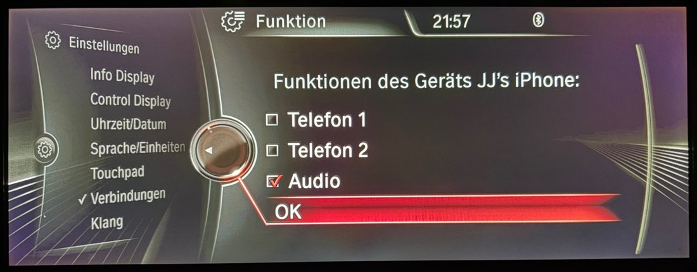

# Wired CarPlay

<!-- SPDX-License-Identifier: GPL-3.0-only -->

Wired CarPlay on the original NBT, through its own USB port and its own Apple authentication chip: no adapter. The
program is `nbt_carplay` (`src/carplay/`, GPLv3) by Valentin Radu, from
[valinet's fork](https://github.com/valinet/nbt-android-auto), where it works since 2026-11-23 (BMW F30, iPhone 15 Pro
Max, iOS 17.7.2): picture, sound, the iDrive controller, Siri, the car microphone, calls and the parking assistant.
The picture is shown by `nbt_decoder` as for Android Auto ([DECODER.md](DECODER.md)).

## In this project

Taken over on 2026-11-24 and tested in one car (BMW F07 2014, iPhone 17 Air, iOS 27.0.1): picture, controller, sound,
titles and cover, Siri and calls with the car microphone, turn hints in the instrument cluster. Changes against the
fork, all in `src/carplay/`:

- **Network format (`cp_usb.c`):** iOS 27 sends its own block format ("ncmx") unless the 16-bit NCM format is set
  first (SET_NTB_FORMAT, request 0x84 with value 0, as Linux `cdc_ncm` does).
- **Sound (`cp_audio.c`):** the mixed 48 kHz stereo output (music, prompts, Siri, calls) is written into this
  project's sound FIFO (`NBT_AA_AUDIO_FIFO`, set by `native_service`) and plays through the same Apple entry as
  Android Auto's sound ("iPod over Bluetooth", `nbt_aa_wms`), not into the amplifier input directly.
- **Titles and cover (`cp_iap2.c`):** the iAP2 NowPlaying updates go into `media.state`, the cover from the iAP2 file
  transfer into `media.cover`, in the format `oneplus_native` writes for Android Auto. `nbt_aa_ipod` shows them in
  iDrive and in the instrument cluster.
- **Turn hints (`cp_iap2.c`):** the identification names a route guidance display (parameter 30), so the iPhone sends
  route guidance and manoeuvre updates (0x5201 / 0x5202) while Apple Maps guides. They go into `nav.state` for
  `nbt_cluster`. Only "start", left and right turns were seen on the car so far; the other manoeuvre types follow a
  table that is not confirmed, roundabouts are taken from the exit angle, lanes are not shown.
- **Picture rate:** `native_service` starts `nbt_carplay --fps 30`; at the iPhone's 60 the car's decoder fell behind.

### Sound: pair the iPhone by Bluetooth, audio only

The sound uses the head unit's Bluetooth audio entry, so the iPhone has to be connected by Bluetooth as well:

1. Pair the iPhone with the car (Settings → Connections → Bluetooth → Add new device).
2. Select the iPhone in that list, press OPTION → **Configure device**, and enable only **Audio**. Telephone 1 and
   Telephone 2 stay off: calls and Siri then stay in CarPlay and use the car's microphone.
3. On the iPhone, pick **CarPlay** as the audio output (AirPlay symbol in the player or in Control Centre).

The music then shows under Multimedia with title, artist, album, cover and progress, and skip works from iDrive, the
steering wheel and the radio panel keys. As with Android Auto, the Bluetooth connection has to come up while the
service is already running: USB first, then Bluetooth (otherwise switch Bluetooth on the iPhone off and on once).



### Limits

- An Android phone and an iPhone cannot be used in the same start of the head unit: the page shows "Restart the NBT
  first" for the second one ([DECODER.md](DECODER.md)).
- CPU load: not measured properly yet. The "98 %" named here before was one short sample taken during testing
  (right after a restart of `nbt_carplay`, picture not shown) and does not hold; the fork's author measures about
  38 % on his car. iDrive felt slower with CarPlay on the developer's car, and the sound path of this project (SBC
  sound device plus the head unit's own player) costs more than the fork's direct path into the amplifier.
- A caller is only heard while the Apple entry is the active sound source.

The rest of this document is the fork's description; where it names the sound path (`input_stereo_1`), the list above
applies here.

## Use

With `nbt_carplay` installed (the installer ships it) and decoder mode on (the default), plugging in an iPhone starts
CarPlay and **Multimedia → Android Auto / CarPlay** brings it to the front. The first time, the iPhone asks "Trust this computer?"; after that it connects by itself, also after a reboot
of the car. Unplugging it ends the session; plugging it in again starts a new one.

| File in `/var/opt/hmi/data/rw/NbtAndroidAutoRT` | Effect |
|---|---|
| `carplay.off` | Apple devices are left to the car's own iPod / USB audio support, as before |
| `carplay.args` | One line of extra arguments for `nbt_carplay`, for example `--no-audio` or `--fps 60` |
| `carplay/` | The pairing with the iPhone (`pair-*`) and the car's AirPlay identity and paired iPhones (`airplay-*`). Deleting it makes the iPhone ask "Trust" again |

If `nbt_carplay` ends early three times in a row, the iPhone is left alone until it is unplugged. Log of each session:
`/fs/ram3/nbt-aa-native/carplay-<session>.log`.

## How it works

The car proves to the iPhone that it is an approved accessory with Apple's authentication chip, over iAP2 (iPod
Accessory Protocol 2); then the iPhone sends its screen (H.264) and sound to the car over AirPlay, through a network
link over the USB cable. Only the car is checked: the iPhone signs nothing.

A car normally switches its USB port to device mode for this (the iPhone becomes the host). The NBT's port is host
only, so the route is the one LIVI and xcertplay (GPL-3.0, <https://github.com/shilapi/xcertplay>) use for Android
head units with the same limitation:

1. A vendor request (0x52, IN, value 0, index 4) makes the iPhone re-connect with extra USB configurations: the Apple
   USB multiplexor (`ff/fe/02`) plus a CDC NCM network function (`02/0d`).
2. Over the multiplexor: lockdown, pairing ("Trust"), TLS, then the service `com.apple.carkit.service`.
3. iAP2 over that service: identification as a CarPlay car, authentication with the chip, then CarPlayStartSession
   tells the iPhone where to connect.
4. A network link over NCM (IPv6 link-local), then AirPlay on port 7000: pairing and encryption, the screen as H.264,
   the sound streams, the microphone and the controller (CarPlay supports a rotary knob).

## The car's authentication chip

`dev-i2c` (`/opt/sys/etc/i2c-conf_x86.cfg`) has it on I2C bus 0 as slave `acp`, address 0x20, node
`/dev/i2c/i2c_0/acp`. Registers from 0: `03 01 02 00 00 00 02 00`: device version 0x03 = **authentication chip 2.0B**,
firmware 1, protocol 2.0 (RSA-1024 with SHA-1). Its certificate (908 bytes, PKCS#7) was issued by "Apple iPod
Accessories Certification Authority" and expired in 2021. The iPhone accepts both the old chip and the expired
certificate for CarPlay. A signature takes about 1.5 s. The chip answers when its register number is written first
and the read follows after a pause.

## Parts of nbt_carplay

native_service starts it when an Apple device is plugged in; the picture goes into `annexb.fifo` for nbt_decoder and
the keys come from nbt_knob's `input.fifo`, as for Android Auto. One run = one iPhone session.

| Part | What it does |
| --- | --- |
| `cp_usb.c` | The CarPlay configuration (vendor request 0x52 if needed), the multiplexor's pipes, the NCM function's data interface (alternate 1) and its MAC address. If the USB stack does not report the new interfaces within 3 s, it connects again. An iPhone plugged in at boot is taken by the car's iPod handlers (`io-fs-media` / `io-audio -dipod`, started by `vdev-medialaunch`); when every interface is held, the handlers of that device are ended |
| `cp_lockdown.c` | Multiplexor, lockdown, pairing (the record is kept; an iPhone that forgot it is paired again), TLS session, `com.apple.carkit.service` |
| `cp_iap2.c`, `cp_acp.c` | iAP2 link, identification, authentication with the chip, power, subscriptions, HID media remote, CarPlayStartSession for each CarPlayAvailability; NowPlaying -> `/fs/ram3/nbt-aa-media` |
| `cp_ncm.c`, `cp_net_lwip.c`, `lwip_port/` | NTB16 blocks <-> Ethernet frames <-> lwIP 2.2.1 inside the process (the car's network is not touched), IPv6 link-local address from the MAC |
| `cp_airplay.c`, `cp_bplist.c`, `cp_crypto.c` | AirPlay: /info (1280x480, knob, no touch), pair-setup (SRP, PIN 3939, Ed25519 with Monocypher), pair-verify (X25519), encrypted control connection, auth-setup (the chip), SETUP, event connection, timing, feedback |
| `cp_screen.c` | Screen stream (type 110) decrypted, AVCC -> Annex B with an access unit delimiter after each frame. On a still screen the iPhone sends no frames, so after 3 s without one it is asked for a key frame (nbt_decoder hides its window after 5 s without a picture) |
| `cp_audio.c`, `cp_mic.c` | LPCM streams -> 48 kHz stereo -> media `input_stereo_1`; prompts on it too or, while another source plays, `input_stereo_3` over b8 (as for Android Auto); microphone `/output_multich_0` -> the iPhone |
| `cp_input.c` | Knob turns -> knob wheel, tilts -> knob x / y, push -> select, BACK -> back, media keys -> media HID, voice -> Siri. `NBT_KNOB_INVERT=1` turns the wheel around |

## Debugging

Run by hand with native_service stopped (or `carplay.off`) and the iPhone plugged in:

```
LD_LIBRARY_PATH=/opt/sys/lib:/lib:/usr/lib ./nbt_carplay --stop-after STEP [--seconds N] [--pcap F] [--dump F] [--audio-dump D]
```

`--stop-after usb` (configuration, pipes, NCM interface up), `iap2` (CarPlayStartSession sent), `net` (the iPhone
connected to port 7000 over NCM), `airplay` (pairing done, screen stream set up), `video` (60 frames written); it ends
N seconds (default 15) later. `--pcap` writes every NCM frame (Wireshark), `--dump` the H.264 (ffplay), `--audio-dump`
one WAV per audio stream. `--fifo none` writes no picture; also `--no-audio`, `--no-mic`, `--knob-invert`.

`nbt_carplay_probe` (`src/carplay/nbt_carplay_probe.c`) tests single steps without a session: `acp` (the chip's
version, certificate and a test signature), `usb` (the iPhone's USB configurations), `usb carplay` (the same after
the vendor request), `lockdown`, `carkit`.

On a PC: `src/carplay/test_ncm_host.c` (two lwIP stacks over NTB16 in random pieces: neighbour discovery, 2 MB TCP
echo, UDP) and `src/carplay/test_airplay_host.c` with `scripts/carplay_test.py` (the iPhone's side of /info, pairing,
encrypted control, auth-setup, SETUP, screen frames, audio packets, event connection, timing, feedback, TEARDOWN).

## Notes

- The pairing keys (two RSA-2048) take about 35 s to make on the car; they are made once and kept.
- The iPhone 15 Pro Max offers 4 USB configurations normally and 6 after the vendor request; 5 and 6 are the CarPlay
  ones.
- No AAC is offered to the iPhone (audio type 102 is left out): the sound comes as LPCM.
- `primaryInputDevice` is 3 (knob); xcertplay uses 1 (touch).
