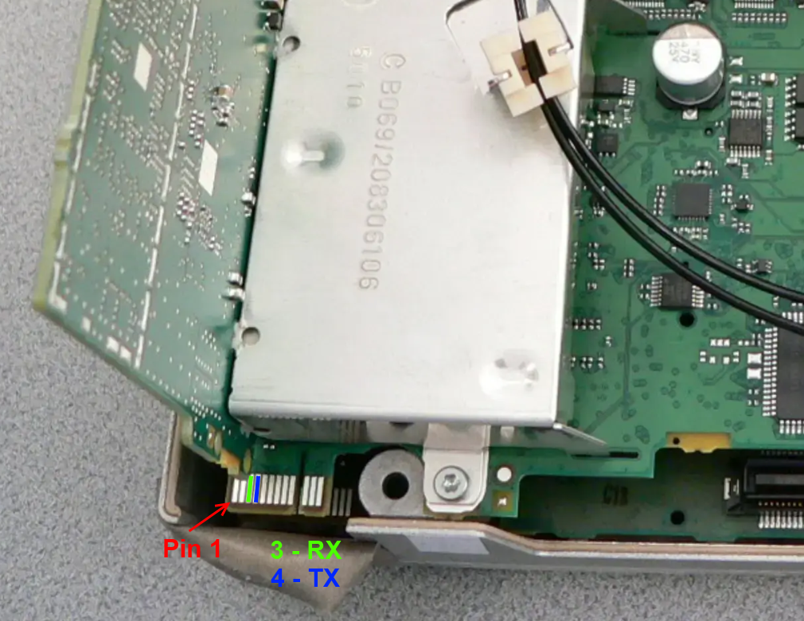

# SSH access through the debug serial port (free method)

SSH on the NBT can also be enabled through the debug serial port on the **Jacinto board**, without FeatureInstaller.
It costs nothing but a USB serial adapter and opening the head unit, and you stay in control of what is written to your
car: nobody else connects to it remotely to install things.

Method and credit: [IPL serial, telnet and SSH (spoolstreet.com)](https://spoolstreet.com/threads/ipl-serial-telnet-and-ssh.9172/).
That thread has the details this page leaves out (serial settings, voltage level, ground).

## Pinout



Pin 1 is marked with the red arrow; **pin 3 = RX** (green), **pin 4 = TX** (blue), as labelled in the picture.

## Enabling SSH

On the serial console (the Jacinto side):

```
on -f hu-intel sh # this connects to shell of Intel board from Jacinto
sysetshell
connect
login Diagnose
getk SYS_DEBUG # this should report 0 by default
setk SYS_DEBUG=0x01
getk SYS_DEBUG # this should report 1 afterwards
store
exit
```

After that, SSH answers on the ENET cable (usually `169.254.199.99`). The default root password is `ts&SK412`.

## ISTA fault after the change

ISTA now reports a fault code saying that the head unit was accessed without authorisation. This is normal and does not
affect how the car works. Setting `SYS_DEBUG` back to 0 (`setk SYS_DEBUG=0x00`, `store`) and clearing the fault makes it
not come back.
